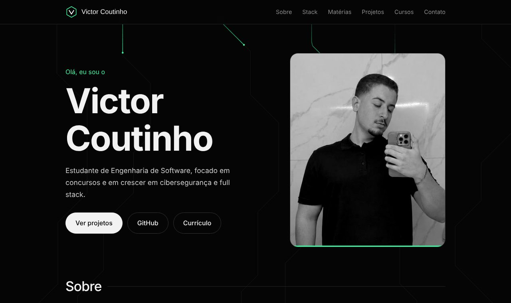

# Portfólio | Victor Coutinho

Meu portfólio pessoal, feito para reunir meus projetos, matérias, cursos e formas de contato.

**Ver online:** https://victor-coutin.github.io/portfolio/



## Sobre o projeto

Sou estudante de Engenharia de Software e este site apresenta quem eu sou, o que estudo e o que já desenvolvi. Meus focos hoje são concursos públicos, cibersegurança e desenvolvimento full stack.

## O que tem no site

- Apresentação e foto
- Stack de tecnologias que uso
- Matérias cursadas e em andamento na faculdade
- Projetos com prévia (ReservEI, Direitos TEA, Presidentes do Brasil, HoyalPet e 12 de Outubro)
- Cursos concluídos, com o certificado em PDF
- Links de contato e botão para baixar o currículo

## Tecnologias

- HTML
- CSS
- JavaScript, sem bibliotecas

O fundo animado de linhas é desenhado com JavaScript em um `<canvas>`, e o layout é responsivo, com menu próprio para celular.

## Estrutura

```
index.html      estrutura da página
style.css       estilos
script.js       fundo animado e ícones da stack
img/            foto e imagens dos projetos
certificados/   certificados em PDF
curriculo-victor-coutinho.pdf
```

## Como abrir no computador

1. Baixe ou clone este repositório.
2. Dê dois cliques no `index.html`. Não precisa instalar nada.

## Contato

- [LinkedIn](https://www.linkedin.com/in/victor-coutinho-3b630a3b6)
- [GitHub](https://github.com/Victor-Coutin)
